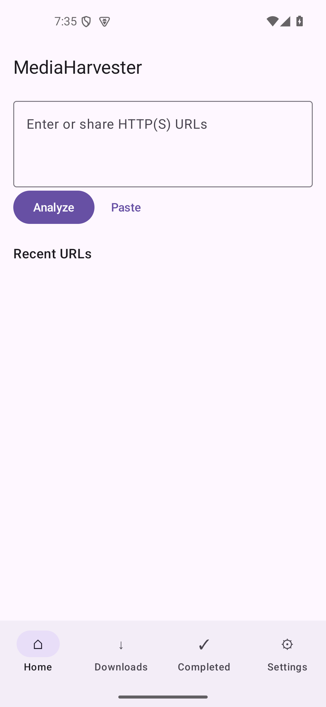

# MediaHarvester Android

原生 Kotlin / Jetpack Compose / Material 3 Android 媒体下载器。独立于 [Windows 原项目](https://github.com/seki999/MediaHarvester)，未修改 Windows 版。所有解析、下载、校验与合并均在设备本机执行，无 PC/远程后端。

这是可构建、已通过 Android 15 x86_64 模拟器测试的开发版，**不是所有机型和网站均已验收的正式版本**。尤其：原生依赖存在16KB页面兼容缺口；检测到大于4KB页面时停用yt-dlp/FFmpeg，仍可使用直接HTTP下载及静态网页图片。arm64 APK已构建，物理arm64设备尚未验证。



## 使用

1. 在首页输入多行HTTP(S)网址、粘贴剪贴板，或从其他应用分享文本到MediaHarvester。
2. 点击解析，选择真实存在的视频/音频格式；图片网格可全选、取消全选、按已知宽度及格式过滤。
3. 入队后在“下载中”暂停、恢复、取消或重试。完成文件可打开/分享。
4. 默认保存到系统 `Downloads/MediaHarvester`，图片可选 `Pictures/MediaHarvester`；设置中可以用SAF选择目录。
5. Cookies仅通过设置明确授权单网站并手动导入Netscape cookies.txt；在本地加密保存。不读取浏览器、不绕过访问权限、DRM或验证码。

重启或系统终止进程后保留任务记录，默认暂停，打开应用后手动继续。不要把应用后台服务视为永久运行保证。源站403/429、登录、删除或格式变化可能导致失败。

## 构建

需要JDK17、Android SDK35、网络下载Maven依赖；Android Studio打开根目录即可。
最低Android10/API29，compile/target35。Gradle8.9 Wrapper、AGP8.7.3、Kotlin2.0.21。
不需要本机安装Python或FFmpeg来运行APK。

```powershell
# Windows；Linux/macOS用 ./gradlew
.\gradlew.bat :app:assembleDebug
# 较小的 arm64-only APK
.\gradlew.bat :app:assembleDebug -PtargetAbis=arm64-v8a
# 安装（仅连接目标设备时）
adb install -r app\build\outputs\apk\debug\app-debug.apk
```

默认构建包含arm64-v8a和x86_64；x86_64用于模拟器测试。`-PtargetAbis=arm64-v8a,x86_64`可显式选择。
如SDK未自动识别，在本机`local.properties`中设`sdk.dir`（不要提交本机路径）。
当前交付APK位置、校验值和测试范围见[验证记录](docs/validation.md)。首次初始化媒体运行时需要额外的设备存储空间。

```powershell
.\gradlew.bat :domain:test :downloader:test :extractor:testDebugUnitTest :app:lintDebug
# 已启动 Android 15 / 4KB页面 x86_64 模拟器时
.\gradlew.bat :app:connectedDebugAndroidTest :database:connectedDebugAndroidTest
# 依赖变更后收集清单和已嵌入的许可
.\gradlew.bat :app:dependencyInventory
python scripts/collect_notices.py
# 检查APK，包括嵌套原生ZIP中的ELF
python scripts/native_audit.py app/build/outputs/apk/debug/app-debug.apk
```

单元测试使用MockWebServer，设备测试使用本地生成的PNG、WAV、真实FFmpeg视频/音轨及DASH分片，不依赖登录、DRM或第三方网站稳定性。测试注入的HTTP客户端仅用于本地服务器，不是生产设置中的私网绕过开关。

## 文档与验证边界

- [移植矩阵与引擎评估](docs/PORTING_MATRIX.md)
- [架构、状态机、恢复与后台限制](docs/ARCHITECTURE.md)
- [功能完成清单](docs/FEATURES.md)
- [实际构建与测试记录](docs/validation.md)
- [Release签名和发布](docs/RELEASE.md)
- [后台、超时与机型验收步骤](docs/DEVICE_TEST_PLAN.md)
- [第三方许可](THIRD_PARTY_NOTICES.md)、[依赖坐标](docs/dependencies.tsv)、[原生ELF检查](docs/native-audit.json)

当前范围：静态HTML图片；最多100条播放列表；按任务限速；不支持直播和JS渲染页面。
不承诺HLS/DASH跨进程碎片续传；重新下载更安全。部分动态技术错误为英文；平板采用内容宽度和自适应网格，尚未单独进行平板设备验收。
APK包含GPL-3.0封装及GPL FFmpeg，Android组合分发按GPL-3.0，原Windows的MIT许可证保持不变。
完整原生对应源码/构建来源还需审核，见第三方许可文档；本地Debug测试成功不能代替正式分发审核。
